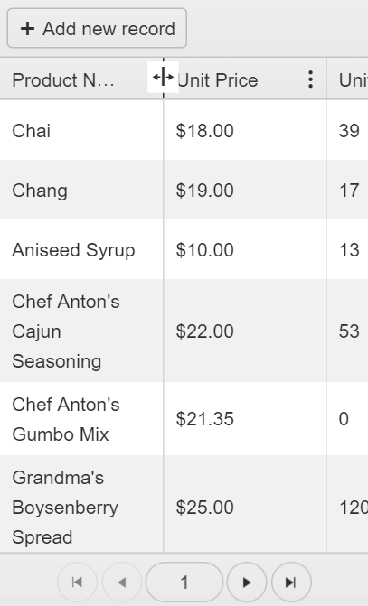

# Adaptive Rendering

The Telerik UI Grid for {{ site.framework }} supports adaptive rendering to provide a consistent experience across device types.

When users filter or edit data on mobile devices, the Grid opens a dedicated view instead of using desktop inline or popup behavior. For a runnable example, review the [adaptive rendering Grid demo](https://demos.telerik.com/{{ site.platform }}/grid/adaptive-rendering).

## Enabling the Responsive Web Design

To enable the adaptive rendering feature, set the [`Mobile`](https://docs.telerik.com/{{ site.platform }}/api/kendo.mvc.ui.fluent/gridbuilder#mobile) property to `MobileMode.Auto` or `MobileMode.Phone`:

* If set to `MobileMode.Auto`, the component uses adaptive rendering when viewed in a mobile browser.
* If set to `MobileMode.Phone`, the component always uses adaptive rendering, regardless of browser type.

>important Set the `height` option when you enable mobile rendering. Without an explicit height, each Grid view can render at a different height.

```HtmlHelper
    @(Html.Kendo().Grid<ProductViewModel>()
        .Name("grid")
        .Mobile()
        .HtmlAttributes(new { style = "height:450px;" })
        .DataSource(dataSource => dataSource
            .Ajax()
            .Read(read => read.Action("Products_Read", "Home"))
        )
    )
```

```TagHelper
<kendo-grid name="grid"
            mobile-enabled="true"
            height="450">
    <datasource type="DataSourceTagHelperType.Ajax">
        <transport>
            <read url="@Url.Action("Products_Read", "Home")"/>
        </transport>
    </datasource>

</kendo-grid>
```


## Resizing Columns

The column resizing feature on touch screen devices is triggered when the user holds a finger on the respective column header. When the resizing icon appears, the user can resize the column by dragging.



## Destroying Adaptive Grids

When the Grid runs in adaptive rendering mode, it generates auxiliary markup that you must remove if you manually `destroy` the Grid.

To manually destroy the Grid:

1. Call the Kendo UI for jQuery [`kendo.destroy()`](https://docs.telerik.com/kendo-ui/api/kendo/methods/destroy) method over the closest `.k-pane-wrapper` ancestor which is created around the Grid.
1. Remove the whole `.k-pane-wrapper` element from the DOM.

## See Also


* [ASP.NET Core DataGrid Homepage](https://www.telerik.com/aspnet-core-ui/grid)

* [Responsive Columns by the Grid HtmlHelper for {{ site.framework }} (Demo)](https://demos.telerik.com/{{ site.platform }}/grid/responsive-columns)
* [Adaptive Rendering by the Grid HtmlHelper for {{ site.framework }} (Demo)](https://demos.telerik.com/{{ site.platform }}/grid/adaptive-rendering)
* [Server-Side API](/api/grid)
