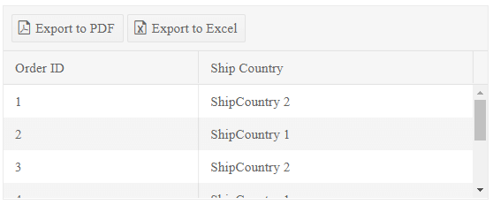

# Height

By default, the Grid has no set height and expands to fit all table rows.

## Getting Started

>note Set the Grid height only when scrolling is enabled. For details about supported scroll modes, see [Scroll Modes of the Grid HtmlHelper for {{ site.framework }}]().

To set the height of the Grid, use any of the following approaches:
* Apply an inline height style to the `<div>` from which the Grid is initialized.
* Use the `height` property of the Grid which will apply an inline style to the Grid wrapper&mdash;the same as the previous option.
* Use external CSS. For example, use the ID or the `.k-grid` CSS class to apply a height style.

When you set the Grid height, the component calculates the correct height of the scrollable data area. The total height includes the header rows, filter row, data area, footer, and pager. If you change the Grid height through JavaScript after initialization, call the [`resize` method](https://docs.telerik.com/kendo-ui/api/kendo/methods/resize) so the Grid recalculates the data area height.

```JS
    var gridWidget = $("#GridID").data("kendoGrid");

    // Apply the new height and trigger the layout readjustment.
    gridWidget.wrapper.height(800);
    gridWidget.resize();

    // Force the layout readjustment without setting a new height.
    gridWidget.resize(true);
```

In specific scenarios, set a height style on the scrollable data area by using JavaScript or external CSS on the `div.k-grid-content` element. In these cases, avoid setting a height on the Grid.

```HtmlHelper
    <div style="width:500px;">
        @(Html.Kendo().Grid<OrderViewModel>()
            .Scrollable()
            .HtmlAttributes(new { style = "height: 200px;" })
            /* other configurations */
        )
    </div>
```

```TagHelper
<div style="width:500px">
    <kendo-grid name="grid"
                height="200">
        <scrollable enabled="true" />

    </kendo-grid>
</div>
```




## Setting a Minimum Height

>note A minimum height is not applicable when virtual scrolling is enabled. For details about supported scroll modes, see [Scroll Modes of the Grid HtmlHelper for {{ site.framework }}]().

You can make the Grid expand and shrink vertically based on the number of rows, while keeping it within limits. To do this, apply a minimum or maximum height style to the scrollable data area and do not set a height for the Grid. Remove the default data area height as described in [Scrolling overview](#scrolling-overview). Instead of `GridID`, you can use the `.k-grid` class to target all Grid instances.

```CSS
#GridID .k-grid-content
{
    min-height: 100px;
    max-height: 400px;
}
```

## Enabling Auto-Resizing

>note The auto-resize feature applies only to scrollable Grids. For details about supported scroll modes, see [Scroll Modes of the Grid HtmlHelper for {{ site.framework }}]().

1. To allow the Grid to resize with its parent, apply a `height: 100%` style to the `<div class="k-grid">` wrapper. By web standards, percentage-based height requires an explicit height on the parent. This requirement applies recursively until an element with pixel height or the `html` element is reached. Elements with `height: 100%` cannot have margins, padding, borders, or sibling elements, so remove the default Grid border.
1. Ensure the inner Grid layout adapts to wrapper height changes. If browser window resizing triggers these changes, handle the browser `resize` event and call the Grid [`resize()`](https://docs.telerik.com/kendo-ui/api/kendo/methods/resize) method. The `resize` method measures the Grid `<div>` and adjusts the scrollable data area height.
  * If the Grid is placed inside a Kendo UI Splitter or Kendo UI Window, you do not need to call the `resize` method because these widgets will execute it automatically. Also, it is not necessary to apply the method if you use locked columns.
  * If the vertical space that is available for the Grid depends on a custom resizing of the layout, which is controlled by the user, use a suitable event or method related to the layout changes to execute the `resize` method of the Grid. In this case, call the `resize` method even if you use locked columns.

    ```JS
        $(window).resize(function (e) {
            var grid = $("#GridID").data("kendoGrid");
            grid.resize();
        });
    ```

## Configuring the Loading Indicator

Internally, the Grid uses the [`kendo.ui.progress`](https://docs.telerik.com/kendo-ui/api/ui/ui/methods/progress) method to display a loading overlay during remote `read` requests. If scrolling is disabled, the overlay appears over the whole Grid. If scrolling is enabled, the overlay appears over the scrollable data area. If scrolling is enabled and the Grid has no set height, the data area initially has zero height, which makes the loading overlay invisible during the first remote request. To make the loading overlay visible, use one of the following approaches:
* [Set the height of the Grid](#getting-started), or
* [Apply the `min-height` style](#setting-a-minimum-height) to the `div.k-grid-content` element.

## See Also


* [ASP.NET Core DataGrid Homepage](https://www.telerik.com/aspnet-core-ui/grid)

* [Scrolling by the Grid HtmlHelper for {{ site.framework }} (Demos)](https://demos.telerik.com/{{ site.platform }}/grid/virtualization-remote-data)
* [Scroll Modes of the Grid HtmlHelper for {{ site.framework }}]()
* [Server-Side API](/api/grid)
