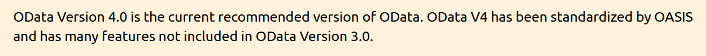

# OData Binding

The Grid component supports OData v4 data binding. For new projects, use the [Grid OData-v4 Binding](https://docs.telerik.com/{{ site.platform }}/html-helpers/data-management/grid/binding/odatav4-binding) approach.



If you are working with an older OData v3 service, this article provides the required concepts and Grid configuration.

## What Is an API?

An application programming interface (API) defines how software systems exchange requests and responses.
It describes the operations, inputs, and outputs that a client uses to communicate with a service.

## What Is a Web API?

A web API is an API that uses HTTP to exchange data between a client and a web server.
All web services are APIs, but not all APIs are web services.
In this model, the client sends requests and the server returns structured responses.

## What Is REST?

Representational State Transfer (REST) is an architectural style for web services.
REST services are stateless and separate client concerns from server concerns.
Clients use HTTP methods such as GET, POST, PUT, and DELETE to request data operations.
The server returns data responses instead of full page rendering.

## What Is OData?

The OData protocol is an application-level protocol for querying and updating data through RESTful web services.
It provides facilities for:

* Metadata: a machine-readable description of the data model exposed by a particular data provider.
* Data: sets of data entities and the relationships between them.
* Querying: requesting that the service perform a set of filtering and other transformations to its data, then return the results.
* Editing: creating, editing, and deleting data.
* Operations: invoking custom logic.
* Vocabularies: attaching custom semantics.

Unlike many REST-based approaches, OData provides a consistent way to describe both the data and its model.
This consistency improves interoperability between systems.

## Creating the Web Service

Create a live service by adding an `.svc` file to your service deployment project:
[Deploy a WCF Service Hosted in Internet Information Services](https://learn.microsoft.com/en-us/dotnet/framework/wcf/feature-details/deploying-an-internet-information-services-hosted-wcf-service?redirectedfrom=MSDN#create-an-svc-file-for-the-wcf-service)

Review the Kendo UI demos service implementation in this public repository:
[Kendo UI Demos Service - demos-and-odata-v3](https://github.com/telerik/kendo-ui-demos-service/tree/master/demos-and-odata-v3)

Add the following configuration to your `Web.config` file:
```xml
  <system.serviceModel>
    <serviceHostingEnvironment aspNetCompatibilityEnabled="true" multipleSiteBindingsEnabled="true" />
  </system.serviceModel>
```

## Binding the Grid

After the web service is available, configure the Grid DataSource to point to the REST API URL:

```HtmlHelper
    .DataSource(dataSource => dataSource
        .Custom()
        .Type("odata-v4")
        .Transport(transport =>
           transport.Read(read => read.Url("https://demos.telerik.com/service/v2/odata/Orders"))
        ) 
        .PageSize(20)
        .ServerPaging(true)
        .ServerSorting(true)
        .ServerFiltering(true)
    )
```

```TagHelper
    <datasource type="DataSourceTagHelperType.Custom" custom-type="odata-v4" page-size="20"
        server-paging="true"
        server-sorting="true"
        server-filtering="true">
        <transport>
            <read url="https://demos.telerik.com/service/v2/odata/Orders"/>
        </transport>
    </datasource>
```


## See Also


* [ASP.NET Core DataGrid Homepage](https://www.telerik.com/aspnet-core-ui/grid)

* [OData Binding by the Grid HtmlHelper for {{ site.framework }} (Demo)](https://demos.telerik.com/{{ site.platform }}/grid/odata)

* [Official Microsoft Documentation on Getting Started with {{ site.framework }} OData](https://learn.microsoft.com/en-us/odata/webapi-8/getting-started?tabs=net60%2Cvisual-studio-2022%2Cvisual-studio)

* [Official Microsoft Documentation on Getting Started with {{ site.framework }} OData](https://learn.microsoft.com/en-us/aspnet/web-api/overview/odata-support-in-aspnet-web-api/odata-v4/create-an-odata-v4-endpoint)

* [OData-v4 Binding by the Grid HtmlHelper for {{ site.framework }}](https://docs.telerik.com/{{ site.platform }}/html-helpers/data-management/grid/binding/odatav4-binding)
* [Grid Server-Side API Reference](/api/grid)