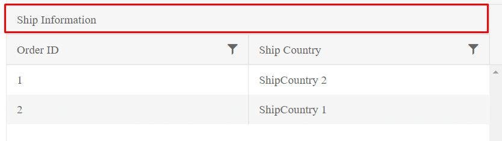

# Multi-Column Headers

The Grid multi-column headers create a tree-like header structure.
You can group one or more columns under a shared parent header.

For a runnable example, refer to the [demo on implementing multi-column headers in the Grid](https://demos.telerik.com/{{ site.platform }}/grid/multicolumnheaders).

The parent header can be a child of another `MultiColumn` header that spans both columns and other headers.

```HtmlHelper
    .Columns(columns =>
    {
        columns.Group(colGroup =>
        {
            colGroup.Title("Ship Information");
            colGroup.Columns(cols =>
            {
                cols.Bound(f => f.OrderID).Width(200);
                cols.Bound(f => f.ShipCountry).Width(200);
            });
        });
    })
```

```TagHelper
    <columns>
        <column field="ContactName" title="Contact Name" width="240" />
        <column title="Contact Info" >
            <columns>
                <column field="ContactTitle" title="Contact Title" width="200" />
                <column field="ContactName" title="Contact Name" width="200" />
                <column title="Location">
                    <columns>
                        <column field="Country" width="200" />
                        <column field="City" width="200" />
                    </columns>
                </column>
                <column field="Phone" />
            </columns>
        </column>
    </columns>
```


The previous example produces the following output.



The following example shows a complete Grid configuration with multi-column headers.

```HtmlHelper
    @(Html.Kendo().Grid<Kendo.Mvc.Examples.Models.CustomerViewModel>()
    .Name("grid")
    .Columns(columns =>
    {
        columns.Bound(c => c.CompanyName).Width(420);
        columns.Group(group => group
            .Title("Contact Info")
            .Columns(info => {
                info.Bound(x => x.ContactTitle).Width(200);
                info.Bound(x => x.ContactName).Width(200);
                info.Group(g => g.Title("Location")
                    .Columns(location =>
                    {
                        location.Bound(c => c.Country).Width(200);
                        location.Bound(c => c.City).Width(200);
                    })
                );
                info.Bound(x => x.Phone);
            })
        );
    })
    .ColumnMenu()
    .Resizable(resizable => resizable.Columns(true))
    .Reorderable(reorderable => reorderable.Columns(true))
    .HtmlAttributes(new { style = "height: 550px;" })
    .Scrollable()
    .Groupable()
    .Sortable()
    .Pageable()
    .DataSource(dataSource => dataSource
        .Ajax()
        .PageSize(20)
        .Read(read => read.Action("MultiColumn_Customers_Read", "Grid"))
    )
)
```

```TagHelper
<kendo-grid name="grid" resizable="true" height="550">
    <datasource type="DataSourceTagHelperType.Ajax" page-size="20">
        <schema data="Data" total="Total" errors="Errors">
        </schema>
        <transport>
            <read url="@Url.Action("MultiColumn_Customers_Read", "Grid")"/>
        </transport>
    </datasource>
    <scrollable enabled="true"/>
    <groupable enabled="true" />
    <sortable enabled="true" />
    <pageable enabled="true"/>
    <column-menu enabled="true"/>
    <reorderable enabled="true" columns="true"/>
    <columns>
        <column field="CompanyName" width="420" />
        <column title="Contact Info" >
            <columns>
                <column field="ContactTitle" title="Contact Title" width="200" />
                <column field="ContactName" title="Contact Name" width="200" />
                <column title="Location">
                    <columns>
                        <column field="Country" width="200" />
                        <column field="City" width="200" />
                    </columns>
                </column>
                <column field="Phone" />
            </columns>
        </column>
    </columns>
</kendo-grid>
```


## See Also


* [ASP.NET Core DataGrid Homepage](https://www.telerik.com/aspnet-core-ui/grid)

* [Implementing Multi-Column Headers in the Grid (Demo)](https://demos.telerik.com/{{ site.platform }}/grid/multicolumnheaders)
* [Server-Side API](/api/grid)
