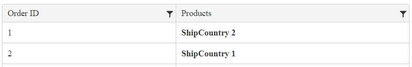

# Row Templates

The Kendo UI Grid supports row templates which enable you to place custom content into a Grid row.

When you use a `ClientRowTemplate`, the template defines the complete `<tr>` and `<td>` markup. To center a cell, add a class or an inline `text-align` style directly to the relevant `<td>` element.

```HtmlHelper
    .ClientRowTemplate("<tr data-uid='#=data.uid#'>" +
        "<td class='toppane-input-wrap'>#=data.OrderID#</td>" +
        "<td class='toppane-input-wrap'>#=data.ShipCountry#</td>" +
    "</tr>")
```

```CSS
    .toppane-input-wrap {
        text-align: center;
    }
```

The `toppane-input-wrap` class in this example is a custom application class, not a Kendo UI class. For standard generated Grid cells, use the column alignment options described in the [content alignment article]().

For runnable examples, refer to:
* [Demo on using the row template of the Grid HtmlHelper for {{ site.framework }}](https://demos.telerik.com/{{ site.platform }}/grid/rowtemplate)
* [Demo on using the detail-row template of the Grid HtmlHelper for {{ site.framework }}](https://demos.telerik.com/{{ site.platform }}/grid/detailtemplate)
* [Demo on using the toolbar template of the Grid HtmlHelper for {{ site.framework }}](https://demos.telerik.com/{{ site.platform }}/grid/toolbar-template)

The following example demonstrates how to use a string row template which generates two columns. The outermost HTML element in the template must be a table row (`<tr>`). That table row must have the `uid` data attribute set to `#= uid #`. The grid uses the `uid` data attribute to determine which data a table row is bound to.

```HtmlHelper
        .ClientRowTemplate("<tr data-uid='#=data.uid#'>" +
            "<td>#=data.OrderID#</td>" +
            "<td><strong>#=ShipCountry #</strong></td>" +
        "</tr>")
```

```TagHelper
    @{
        string rowTemplate = "<tr data-uid='#=data.uid#'>" +
            "<td>#=data.OrderID#</td>" +
            "<td><strong>#=ShipCountry #</strong></td>" +
            "</tr>";
    }
    <kendo-grid name="grid" style="height:430px;"
            row-template="@rowTemplate">
    </kendo-grid>
```





## See Also


* [ASP.NET Core DataGrid Homepage](https://www.telerik.com/aspnet-core-ui/grid)

* [Using Row Templates in the Grid HtmlHelper for {{ site.framework }} (Demo)](https://demos.telerik.com/{{ site.platform }}/grid/rowtemplate)
* [Using Detail-Row Templates in the Grid HtmlHelper for {{ site.framework }} (Demo)](https://demos.telerik.com/{{ site.platform }}/grid/detailtemplate)
* [Using Toolbar Templates in the Grid HtmlHelper for {{ site.framework }} (Demo)](https://demos.telerik.com/{{ site.platform }}/grid/toolbar-template)
* [Server-Side API](/api/grid)
