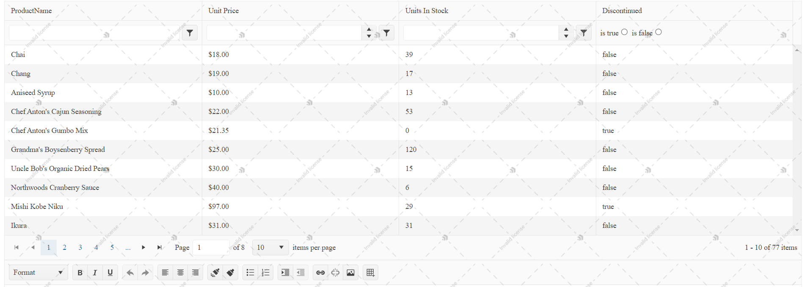
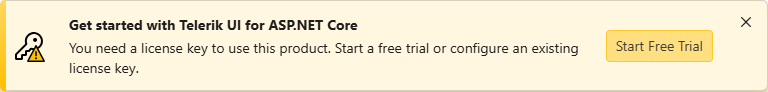
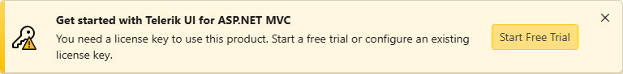

## Environment

<table>
 <tr>
  <td>Product</td>
  <td>{{ site.product }}</td>
 </tr>
 <tr>
  <td>Progress {{ site.product }} version</td>
  <td>2022.3.913</td>
 </tr>
</table>

## Description

After upgrading, there is a warning in the console stating the following:

```
 License Activation failed for @progress/kendo-ui
 No license found
```
A watermark for the component I have been using:



And a banner which indicates that my license is not found:







The image is a an example of the current client-side banner for {{ site.product }}. Its appearance depends on the version used in your application.

The application seems to be running. How can I remove the warning, watermark, and banner?

## Solution

For **2025 Q1 and later**, follow [License Key Installation](). If you have already installed a license key, see [License Key Errors]() for troubleshooting and examples of the current banners and trial notices.

The following script-key instructions apply to the legacy licensing mechanism introduced with **R3 2022**, for versions earlier than **2025 Q1**. To remove the warning in these versions:

* Generate a [license file](https://docs.telerik.com/{{ site.platform }}/documentation/installation/activating-your-license/setting-up-your-license#manual-installation).
* Add the license file after the CDN reference to `kendo.all.min.js` and `kendo.aspnetmvc.min.js`.
    ```
    <script src="https://kendo.cdn.telerik.com/***/kendo.all.min.js"></script>
    <script src="https://kendo.cdn.telerik.com/***/kendo.aspnetmvc.min.js"></script>
    <script src="~/kendo-ui-license.js"></script>

    <!-- Rest of the HTML -->
    ```

> The license file mechanism does not break any builds and does not affect existing applications. It acts as verification when the CDN or NPM distribution channel is utilized for the client-side resources.


## See Also

* [Upgrade Troubleshooting]()
* [Telerik UI for {{ site.framework }} Breaking Changes]()
* [Telerik UI for {{ site.framework }} Knowledge Base](https://docs.telerik.com/{{ site.platform }}/knowledge-base)
