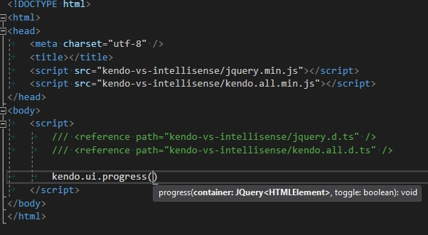
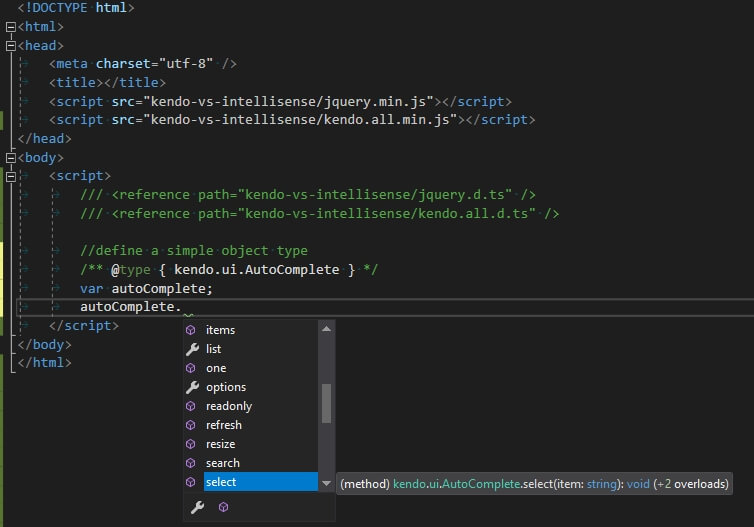
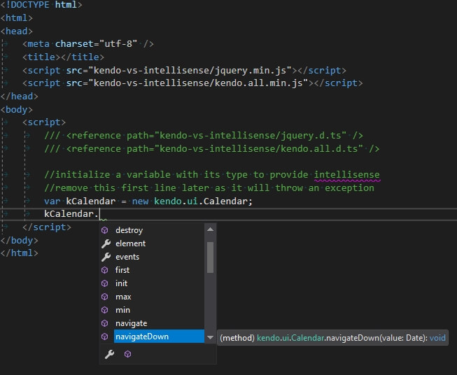

# Visual Studio IntelliSense

Kendo UI provides code completion in Visual Studio through its [TypeScript definitions]().

## TypeScript-Based IntelliSense

Visual Studio 2017 and later use a [TypeScript-based language service for JavaScript IntelliSense](https://learn.microsoft.com/en-us/visualstudio/ide/javascript-intellisense). Use the Kendo UI TypeScript definitions to provide type information for components and their configuration.

For more information on this service, the way it works, and the features it supports, refer to:
* [Microsoft/TypeScript GitHub repo wiki: JavaScript Language Service in Visual Studio](https://github.com/Microsoft/TypeScript/wiki/JavaScript-Language-Service-in-Visual-Studio)
* [Microsoft/TypeScript GitHub repo wiki: JSDoc Support in JavaScript](https://github.com/Microsoft/TypeScript/wiki/JsDoc-support-in-JavaScript)

## Installation

Each distribution bundle includes a `typescript` directory containing `kendo.all.d.ts`. The Kendo UI NPM package also includes the TypeScript definitions. Follow the [TypeScript getting-started instructions](#getting-started) to add them to your project.

## JSDoc Syntax for TypeScript-Based Intellisense

In JavaScript files, use the TypeScript definitions together with JSDoc annotations to provide type information without disabling the TypeScript-based language service.

The following screenshot demonstrates how to add TypeScript references to a JavaScript code block.

The following screenshots demonstrate how to declare variable types with [JSDoc syntax](https://github.com/Microsoft/TypeScript/wiki/JsDoc-support-in-JavaScript).

## See Also

* [Twitter Bootstrap]()
* [Angular 2.0]()
* [RequireJS]()
* [TypeScript]()
* [SystemJS Support]()
* [Webpack Support]()
* [Module Bundlers]()
